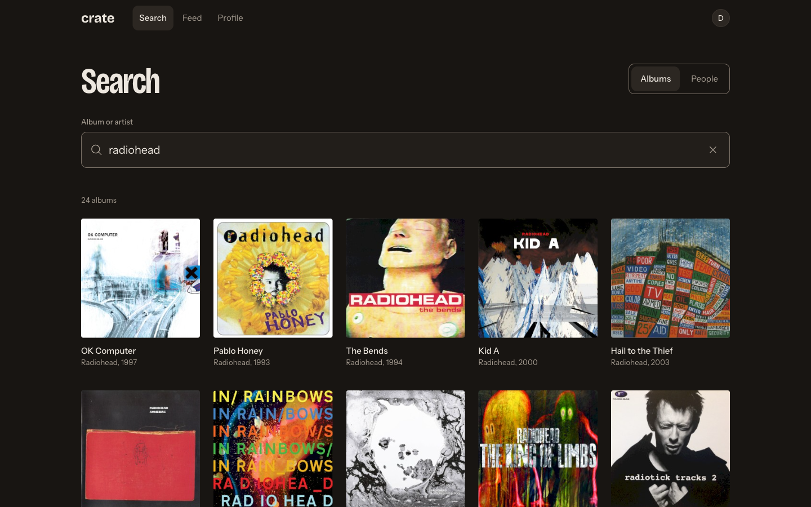
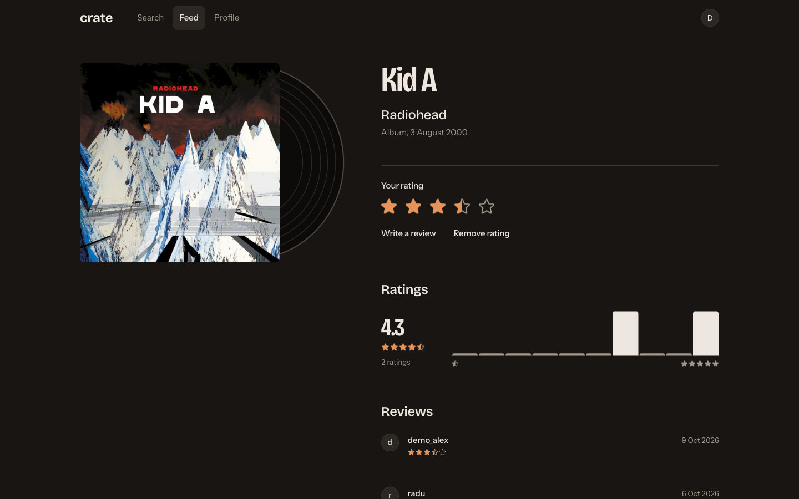
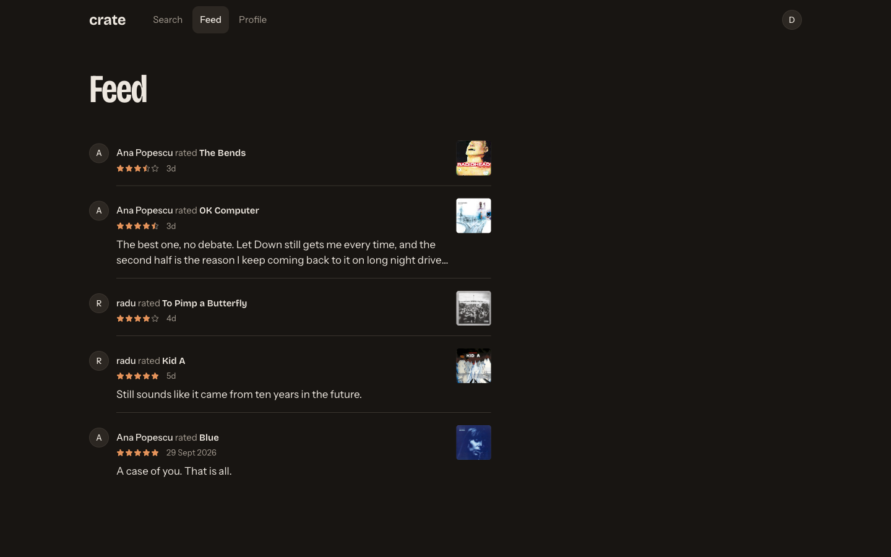
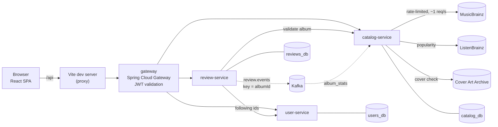

# Crate

[](https://github.com/kerBiy/crate/actions/workflows/ci.yml)

Crate is Letterboxd for albums. It's an invite-only app for a group of friends: search almost any
album ever released (MusicBrainz data), rate it in half stars, write a review, follow friends and see
what they've rated in a feed. The backend is four Spring Boot services that each own a separate
database, plus Kafka for rating events. That's more than a friends app needs, and it's deliberate:
the project exists to work through the problems that only show up with more than one service
([ADR-001](docs/adr/001-microservices.md)). Every decision below has a written ADR, and the numbers
come from measurements that can be rerun.

| Search | Album | Feed |
|---|---|---|
|  |  |  |

## What works today

- Register with an invite code, log in
- Search albums by title, artist or both, with typo tolerance; search people
- Album page with cover, average rating, rating count and a half-star histogram
- Rate in half stars, write, edit or remove a review (with undo)
- Profiles with a user's ratings; follow and unfollow; followers and following lists
- A feed of ratings and reviews from the people you follow

It runs locally for now (see [Run it locally](#run-it-locally)); there's no public deployment yet.

## Architecture



| Service | Owns | Does |
|---|---|---|
| `gateway` | nothing | Single entry point, routing, JWT validation, sets `X-User-Id` |
| `user-service` | users, follows | Registration, login, JWT issuing + JWKS, profiles, follow graph, user search |
| `catalog-service` | albums, artists, search cache, `album_stats` | MusicBrainz integration, search and ranking, album details, rating aggregates built from events |
| `review-service` | reviews | Ratings and reviews, per-album and per-user lists, the feed; publishes `review.events` |

Each service has its own database and its own Postgres role, on one Postgres 17 instance. This is
enforced, not just agreed on: `REVOKE CONNECT ... FROM PUBLIC` on every service database and password
auth on every connection ([ADR-002](docs/adr/002-database-per-service.md)). There are no
cross-service foreign keys or joins. Data from another service comes through its API or through
events. The only code the services share is [`libs/event-contracts`](libs/event-contracts).

## Tech stack

| | |
|---|---|
| Backend | Java 25, Spring Boot 4.1, Spring Cloud Gateway 2025.1, Spring Security (OAuth2 Resource Server, JOSE), Spring for Apache Kafka, Jackson 3 |
| Data | PostgreSQL 17, Flyway migrations per service, Apache Kafka 4 (KRaft, no ZooKeeper) |
| Frontend | React 19, TypeScript, Vite, React Router, TanStack Query, Tailwind CSS 4 |
| Tests | JUnit 5, Testcontainers (Postgres, Kafka), WireMock, Awaitility |
| Build and CI | Gradle multi-project with convention plugins, Docker Compose, GitHub Actions |

## Engineering decisions worth reading

**Rating averages built from Kafka events.** Ratings live in review-service and averages in
catalog-service, so a database join isn't possible. review-service publishes `ReviewCreated`,
`ReviewUpdated` and `ReviewDeleted` to `review.events`, keyed by album ID so all events for one album
stay in order on one partition. catalog-service applies each event to `album_stats` and records the
event ID in `processed_events` in the same transaction, so a redelivered event is skipped. The offset
is committed only after that transaction commits. Events are published after the review's DB commit,
which leaves a known dual-write gap: a crash right after the commit can lose an event. That trade-off,
the alternatives (outbox, CDC, Kafka transactions) and the damage control are written up in
[ADR-006](docs/adr/006-publish-after-commit.md). Code:
[`ReviewEventPublisher`](services/review-service/src/main/java/io/github/kerbiy/crate/review/events/ReviewEventPublisher.java),
[`ReviewEventListener`](services/catalog-service/src/main/java/io/github/kerbiy/crate/catalog/stats/ReviewEventListener.java),
[`AlbumStatsService`](services/catalog-service/src/main/java/io/github/kerbiy/crate/catalog/stats/AlbumStatsService.java).

**JWT validated once, at the gateway.** user-service is the only service that can issue tokens:
they're signed with RS256, and the public key is published as a JWK Set with a `kid`. The gateway
verifies the signature, `exp` and `iss` on every protected route. It also removes any `X-User-Id` the
client sent before setting it from the token. A failed login gives the same response and takes the
same time whether or not the account exists. Why RS256 over HS256, JWKS over a copied key, and what
isn't solved yet (revocation): [ADR-004](docs/adr/004-jwt-rs256-jwks.md).

**MusicBrainz under a 1 request/second limit.** Crate doesn't import the MusicBrainz database. It
fetches albums when someone searches for them and caches the ranked results per query. A hand-written
token bucket (tested with a fake clock) keeps every request to MusicBrainz within its limit, and
HTTP 503 is retried with jittered exponential backoff. If MusicBrainz is down, search returns local
results marked `partial`, so a search never fails because MusicBrainz is unavailable.
[ADR-003](docs/adr/003-musicbrainz-lazy-ingestion.md).

**Search quality, measured.** Searching "radiohead" used to show "Radiohead Box" above OK Computer.
Before changing anything I built a 30-query evaluation set with the expected albums by MBID, and a
script that scores the live endpoint ([`search-eval`](services/catalog-service/search-eval)). Six root
causes later, the rebuilt query and ranking went from **13/30 to 28/30 in the top 3, MRR 0.377 →
0.844**, with no query getting worse ([ADR-010](docs/adr/010-search-ranking.md)). Adding ListenBrainz
listener counts to the ranking was then tuned on that set and checked once on a held-out set and a
niche set: **hit@1 24 → 26 (main), 19 → 21 (held-out), niche unchanged at 9/9**. If ListenBrainz
fails or takes more than 400 ms, search uses the old ranking instead of failing
([ADR-012](docs/adr/012-listenbrainz-popularity.md)).

**Deezer as a source: evaluated, rejected.** A spike scored Deezer's search on the same sets. It ranked
mainstream queries better (29/30 vs 28/30 in the top 3) and answered faster (median 381 ms vs 1689 ms
cold). It only found 5 of the 9 niche albums (Romanian, Bandcamp-only, pre-1970), though, against 9/9
for MusicBrainz. A site for logging *any* album can't lose those, so MusicBrainz stays.
[ADR-011](docs/adr/011-deezer-rejected.md).

**Feed v1 is fan-out on read.** The feed queries the reviews of everyone you follow, with keyset
pagination. If user-service can't answer, the feed returns 503 instead of an empty feed, because "you
follow nobody" and "we couldn't check" shouldn't look the same.
[ADR-007](docs/adr/007-feed-fan-out-on-read.md).

All ADRs: [`docs/adr`](docs/adr). The full design: [`docs/SPEC.md`](docs/SPEC.md).

## Run it locally

Prerequisites: JDK 25, Docker, Node 24, OpenSSL, make.

```bash
cp infra/compose/.env.example infra/compose/.env   # then fill in the values
make jwt-keys                                       # RSA key user-service signs tokens with (git-ignored)
(cd frontend && npm ci)
make dev                                            # Postgres + Kafka, the four services, Vite
make status                                         # wait until everything says UP (~10-20 s)
```

Open <http://localhost:5173> and register with one of the `INVITE_CODES` from your `.env`.
`make stop` stops everything and keeps the data. Logs are in `./logs`.

## Tests

```bash
./gradlew build   # needs Docker for Testcontainers
```

**262 backend tests.** 149 of them are integration tests that run against real Postgres and Kafka in
Testcontainers. They cover the service endpoints and the Kafka consumer. MusicBrainz, ListenBrainz and the Cover Art
Archive are stubbed with WireMock, so no test calls a real external API. CI runs the build and tests,
plus frontend lint, type-check and production build, on every pull request and every push to main. The frontend
has no unit tests yet.

## What's next

- **Deploy**: one small VM with Docker Compose and Caddy, images pushed from CI.
- **Covers from our own storage**: fetch each cover once and serve it ourselves, instead of browsers
  loading it from the Cover Art Archive ([ADR-011](docs/adr/011-deezer-rejected.md)'s decision).
- **No more lost events**: transactional outbox instead of publish-after-commit, retries and a
  dead-letter topic for consumers. Test: stop Kafka during writes and lose nothing.
- **activity-service**: fan-out-on-write feed, notifications, "send an album to a friend".
- **Resilience**: circuit breakers on service-to-service calls, short access tokens with a rotating
  refresh token.
- **Operate it**: k3s, Prometheus and Grafana, tracing across services and Kafka, k6 benchmarks of
  feed v1 vs v2.

## Repo layout

```
services/          gateway, user-service, catalog-service, review-service
libs/              event-contracts (the only shared code)
frontend/          React + TypeScript SPA
infra/compose/     local Postgres and Kafka
docs/adr/          architecture decision records
docs/SPEC.md       full design and roadmap
```
